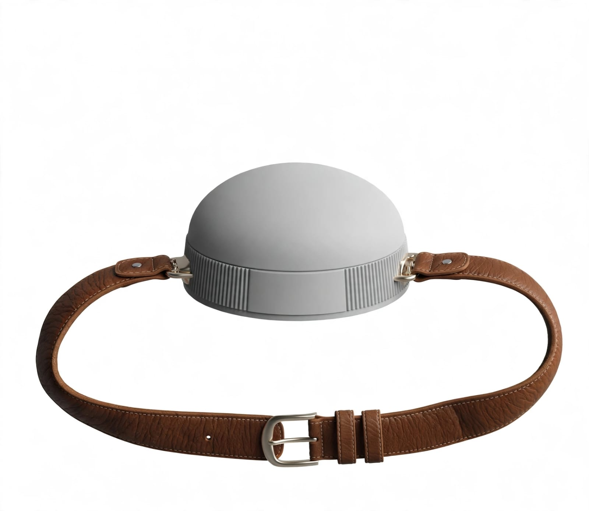

# 🏠 Equilibrio Seguro · Cinturón Inteligente MR

Juego de **realidad mixta (mixed reality)** donde el jugador lleva puesto el **Cinturón Guardián**: un cinturón inteligente que vigila cada movimiento y emite alertas si detecta **movimientos bruscos**, **marcha errática** o una **caída**.

El jugador camina por una casa virtual (sala, cocina, cuarto, baño y habitación principal) con muebles, dos personas y mascotas, completando una ruta guiada mientras el cinturón cuida su estabilidad.



## ✨ Características

- **Cinturón inteligente simulado** con panel en vivo: velocidad, pasos, distancia, tipo de marcha y barra de estabilidad con LED de estado.
- **Detección de movimientos bruscos** (aceleración/jerk), **marcha errática** (zigzag y giros excesivos en ventana de 6 s) y **caídas** (impacto + inmovilidad), con niveles de sensibilidad (baja/media/alta).
- **Peligros en la casa**: juguetes en el suelo, suelo mojado y 🐶 Max, que se cruza en tu camino. Ir deprisa con estabilidad baja puede terminar en caída.
- **Protocolo de caída**: alarma sonora, vibración, cuenta atrás de 12 s y aviso al cuidador (simulado) si no respondes.
- **Casa 3D completa**: 5 habitaciones, muebles, TV encendida, 👩‍⚕️ cuidadora Ana, 👨 familiar Carlos, 🐶 perro Max y 🐈 gata Mishi.
- **Tres formas de jugar**: pantalla (PC), móvil táctil y **gafas AR/VR vía WebXR** (en AR la casa se ve como holograma sobre tu espacio real).
- **Sensores reales**: en móvil, el cinturón fusiona el acelerómetro del teléfono; en XR usa el movimiento físico de la cabeza.
- **Comandos por voz** 🎙️: di «llamar al cuidador», «ayuda» o «socorro» para avisar a Ana (ella camina hacia ti); si te caes, la app pregunta en voz alta y puedes responder «estoy bien» o «cuidador». Requiere Chrome/Edge con micrófono.

## 🎮 Cómo jugar

1. Abre `index.html` (o la URL publicada) y elige modo (**Ruta guiada** / **Paseo libre**) y sensibilidad.
2. Pulsa **Jugar en pantalla**, o **Entrar en AR / VR** si tu dispositivo lo soporta.
3. Sigue la flecha ➤ y el minimapa para visitar los 6 puntos en orden.
4. Camina con calma: frenar o girar de golpe, zigzaguear rápido o chocar muebles baja tu estabilidad.
5. Si caes, confirma **“Estoy bien”** antes de que acabe la cuenta atrás.

### Controles

| Plataforma | Moverse | Mirar | Correr | Extras |
|---|---|---|---|---|
| PC | WASD / flechas | Ratón (clic para capturar) o Q/E | Shift | T = tropiezo · C = probar caída · M = sonido · H = ayuda |
| Móvil | Palanca izquierda | Giroscopio (mover el móvil) o arrastrar | Palanca al máximo | 🧭 giroscopio · ⛶ pantalla completa (auto) |
| AR/VR | Caminar físicamente + stick del mando | Mover la cabeza | — | Botón 🥽 en el HUD |

## 🚀 Publicar en una página web

No requiere compilación: es HTML + CSS + JS estático (Three.js por CDN) con rutas relativas, listo para GitHub Pages (incluye `.nojekyll`).

**Activar GitHub Pages (1 minuto):**
1. En el repo, ve a **Settings → Pages**.
2. En *Build and deployment → Source*, elige **Deploy from a branch**.
3. En *Branch*, selecciona `arena/45825abf-alerta-para-pacientes-con-alzh` (o `main` si ya fusionaste el juego) y carpeta `/ (root)` → **Save**.
4. Espera ~1 minuto y abre: `https://vealvarezc.github.io/Alerta-para-pacientes-con-alzheimer/`

Otras opciones: **Netlify / Vercel / Cloudflare Pages** (arrastra la carpeta o conecta el repo; sin comando de build) o cualquier hosting con HTTPS.

> ⚠️ **HTTPS es obligatorio** para WebXR (gafas AR/VR) y para los sensores del móvil. `localhost` también vale para probar.

### Probar en local

```bash
# con Python
python3 -m http.server 8080
# abre http://localhost:8080
```

## 🥽 Notas de WebXR (gafas de realidad aumentada)

- Navegadores compatibles: **Chrome/Edge en Android** (ARCore) y **Meta Quest Browser** (VR/AR).
- En **AR** la casa se vuelve semitransparente (holograma) y tu caminar físico mueve al jugador 1:1; el cinturón analiza tu movimiento real.
- En **VR** puedes combinar caminar físico (zona segura) con el stick del mando.
- Si el navegador no soporta WebXR, los botones se deshabilitan y se juega en pantalla sin problema.
- **¿Sin gafas?** Usa el modo **AR con cámara**: muestra tu habitación real con la casa como holograma y miras moviendo el móvil (el menú explica por qué los botones AR/VR están deshabilitados en tu dispositivo).

## 📁 Estructura

```
index.html          → página principal (menú, HUD, modales)
css/styles.css      → estilos responsive (PC + móvil)
js/
  main.js           → arranque, renderer, bucle, cableado XR
  config.js         → constantes, ruta, sensibilidades
  game.js           → estados, ruta, peligros, puntuación, protocolo de caída
  belt.js           → Cinturón Guardián (fusión de sensores + detectores)
  world.js          → casa, muebles, colisiones, obstáculos, marcadores
  actors.js         → personas y mascotas con IA de deambulación
  player.js         → movimiento 1ª persona + locomoción XR
  input.js          → teclado, ratón, táctil (palanca + mirada)
  xr.js             → sesiones immersive-ar / immersive-vr
  audio.js          → sonidos sintetizados (sin archivos)
  ui.js             → HUD, minimapa, alertas, resultados
assets/cinturon.jpg → foto de referencia del cinturón
```

## 🔧 Ideas para extender

- Conectar un cinturón físico por **WebBluetooth** (IMU real) en `belt.js`.
- Multijugador (ver al cuidador en tiempo real) con WebRTC/WebSockets.
- Más niveles: jardín, centro de día, habitación de hospital.
- Guardar récords en `localStorage` y tabla de puntuaciones.

Hecho con 💚 para la seguridad de pacientes con Alzheimer.
